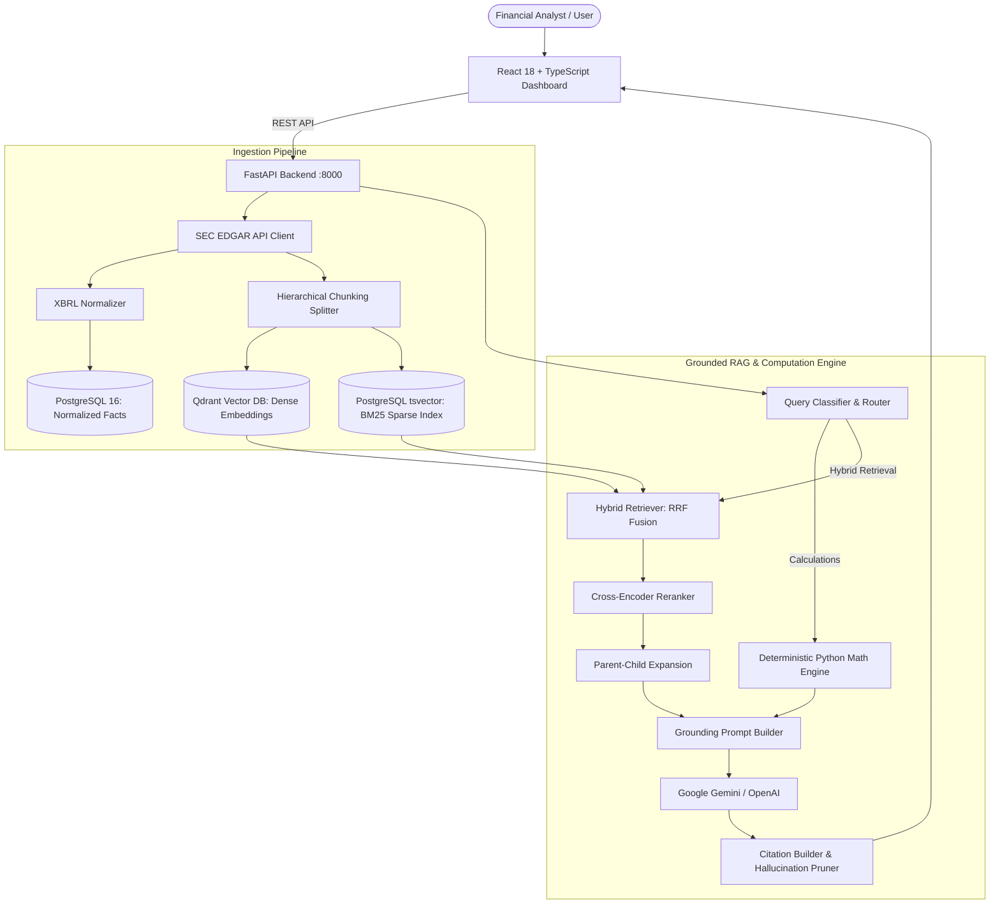

# SEC Financial Intelligence Engine
### Production-Minded Multi-Year SEC 10-K/10-Q Financial RAG Platform

An enterprise-grade financial research engine that parses multi-year SEC 10-K and 10-Q filings, normalizes XBRL data, performs deterministic Python calculations (zero-hallucination math), retrieves disclosure evidence using Reciprocal Rank Fusion (hybrid dense + sparse search), and generates answers with verifiable source citations and EDGAR audit links.

---

## 🏛️ System Architecture



---

## ✨ Key Features

1. **Deterministic Python Financial Engine**:
   - Arithmetic is computed exclusively in Python — never entrusted to an LLM.
   - Calculates Gross Margin, Operating Margin, Net Margin, Debt-to-Equity, YoY Growth, and Free Cash Flow.
   - CapEx outflow normalization: handles signs correctly regardless of filing convention.
   - Guarded against zero-division and missing filing periods.

2. **Hybrid RAG with Reciprocal Rank Fusion (RRF)**:
   - **Dense Retrieval**: Qdrant vector store using cosine similarity.
   - **Sparse Retrieval**: PostgreSQL `tsvector` with BM25-equivalent ranking.
   - **Rank Fusion**: Reciprocal Rank Fusion ($k=60$) combining semantic and keyword signals.
   - **Parent-Child Chunking**: Retrieves focused child passages (~200 tokens) while providing full section/table parent context to the LLM.

3. **Verifiable Source Citations & EDGAR Audit Trail**:
   - Every generated numerical figure or disclosure is tagged with a verifiable citation tag `[SRC-...]`.
   - Clicking any citation in the UI opens the **Citation Inspector Modal**, showing the exact verbatim filing chunk, parent context, document section, and direct link to the SEC EDGAR filing.
   - Automated citation validator removes any hallucinated citation tags.

4. **Multi-Year Comparative Analysis**:
   - Classifies multi-period and comparative queries (e.g. "Compare revenue and net income between FY2022 and FY2023").
   - Fuses disclosures across multiple annual filings with chronological ordering.

5. **Strategy Benchmarking & Evaluation**:
   - Built-in golden evaluation suite covering direct extraction, ratio calculations, multi-year comparisons, qualitative risks, and unanswerable boundary questions.
   - Compares retrieval performance across Hybrid RRF, Dense Only, Sparse Only, and Reranked modes.

---

## 🚀 Quick Start with Docker Compose

### 1. Configure Environment
```bash
cp .env.example .env
```
Edit `.env` to supply:
- `SEC_USER_AGENT`: Name and contact email required by SEC EDGAR (e.g., `FinancialAnalyst analyst@firm.com`).
- `GEMINI_API_KEY`: Google Gemini API key (or `OPENAI_API_KEY`).
  > *Note: If no AI key is provided, the engine runs in **Limited Mode**, supporting all deterministic calculations, XBRL lookups, and hybrid document retrieval.*

### 2. Launch Services
```bash
docker compose up --build
```
This starts:
- **PostgreSQL 16**: Port `5432`
- **Qdrant Vector DB**: Port `6333`
- **FastAPI Backend**: Port `8000` (`http://localhost:8000/docs`)
- **React Frontend**: Port `5173` (`http://localhost:5173`)
- **Background Worker**: Queue runner for large ingestion workloads

---

## 💻 Local Development Setup

### Backend
```bash
cd backend
python -m venv .venv
# On Windows:
.venv\Scripts\activate
# On Linux/macOS:
source .venv/bin/activate

pip install -r requirements.txt
uvicorn app.main:app --reload --port 8000
```

### Frontend
```bash
cd frontend
npm install
npm run dev
```
Open [http://localhost:5173](http://localhost:5173) in your browser.

---

## 🧪 Testing

Run backend unit tests (includes calculator, query router, RRF fusion, and citation builder):
```bash
uv run pytest backend/tests
```

Run frontend production build verification:
```bash
cd frontend
npm run build
```

---

## 📊 Evaluation & Benchmarking

You can run benchmarks directly from the UI under the **"Evaluation & Benchmarks"** tab, or trigger them via API:
```bash
curl -X POST http://localhost:8000/api/evaluations/run \
  -H "Content-Type: application/json" \
  -d '{"name": "Hybrid Benchmark", "config": {"retrieval_mode": "hybrid", "use_reranker": true}}'
```

---

## ☁️ Deployment on Render (Free Tier Optimized)

This repository is pre-configured for **Render Free Tier** (512 MB RAM, 512 MB Disk) using a unified full-stack service (`render.yaml`).

### Option 1: Automatic Blueprint (Recommended)
1. Push your repository to **GitHub**.
2. Go to your [Render Dashboard](https://dashboard.render.com/) and click **New +** -> **Blueprint**.
3. Connect your GitHub repository.
4. Render will detect `render.yaml` and configure the service automatically.
5. Add your optional API keys in the Render Dashboard:
   - `GEMINI_API_KEY` (or `OPENAI_API_KEY`)
   - `SEC_USER_AGENT` (e.g., `FinancialAnalyst contact@yourdomain.com`)
6. Click **Apply**. Render will build the frontend into static assets, install lightweight Python dependencies, and launch FastAPI serving both the UI and API under a single URL with **zero CORS issues**.

### Option 2: Manual Web Service Setup
If creating a Web Service manually on Render:
- **Environment:** `Python 3`
- **Build Command:**
  ```bash
  cd frontend && npm install && npm run build && cd .. && pip install --upgrade pip && pip install -r backend/requirements.txt
  ```
- **Start Command:**
  ```bash
  cd backend && uvicorn app.main:app --host 0.0.0.0 --port $PORT --workers 1
  ```
- **Environment Variables:**
  - `PYTHON_VERSION`: `3.11.9`
  - `NODE_VERSION`: `20.10.0`
  - `APP_ENV`: `production`
  - `SEC_USER_AGENT`: `SEC-Financial-Intelligence/1.0 (contact@yourdomain.com)`

---

## 📄 License
MIT License.
